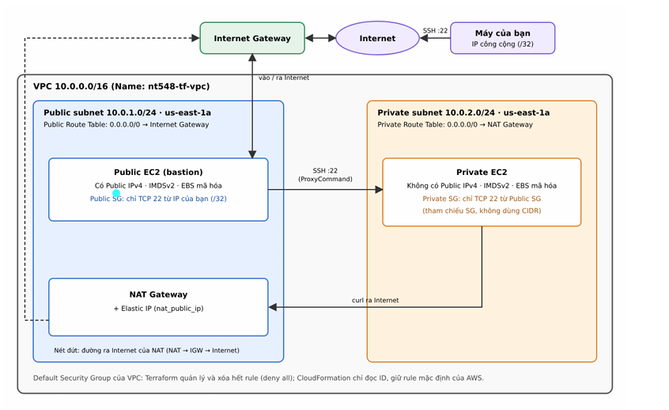

# NT548 – Lab 01: Terraform và CloudFormation trên AWS

Triển khai hạ tầng mạng và máy chủ trên AWS (VPC, Route Tables, NAT Gateway, EC2, Security Groups) bằng hai công cụ Infrastructure as Code:

- **Terraform** viết theo dạng **module**.
- **CloudFormation** viết theo dạng **nested stacks**.

Kèm bộ test tự động (14 test case bằng AWS CLI) và các test SSH thủ công để kiểm tra kết nối, cô lập mạng và giới hạn truy cập.

Repo: <https://github.com/PQPhatUIT/NT548-Lab01>

## Mục lục

1. [Giới thiệu và sơ đồ kiến trúc](#1-giới-thiệu-và-sơ-đồ-kiến-trúc)
2. [Yêu cầu](#2-yêu-cầu)
3. [Chuẩn bị](#3-chuẩn-bị)
4. [Chạy Terraform](#4-chạy-terraform)
5. [Chạy CloudFormation](#5-chạy-cloudformation)
6. [Chạy test](#6-chạy-test)
7. [Lưu ý bảo mật](#7-lưu-ý-bảo-mật)
8. [Cảnh báo chi phí](#8-cảnh-báo-chi-phí)
9. [IP động](#9-ip-động)
10. [Khác biệt giữa Terraform và CloudFormation](#10-khác-biệt-giữa-terraform-và-cloudformation)
11. [Xử lý lỗi thường gặp](#11-xử-lý-lỗi-thường-gặp)

## 1. Giới thiệu và sơ đồ kiến trúc



| Thành phần | Giá trị |
|---|---|
| Region / AZ | `us-east-1` / `us-east-1a` |
| VPC | `10.0.0.0/16` |
| Public subnet | `10.0.1.0/24` – route `0.0.0.0/0` → Internet Gateway |
| Private subnet | `10.0.2.0/24` – route `0.0.0.0/0` → NAT Gateway |
| NAT Gateway | Đặt ở public subnet, gắn Elastic IP |
| Public EC2 | Có public IP (bastion). Public SG chỉ cho SSH (22) từ IP của người dùng (`/32`) |
| Private EC2 | Không có public IP. Private SG chỉ cho SSH từ Public SG |
| Instance | Amazon Linux 2023, `t3.micro`, bắt buộc IMDSv2, mã hóa EBS |

Luồng truy cập:

- **Máy của bạn → Public EC2:** SSH trực tiếp (chỉ từ IP đã cho phép).
- **Máy của bạn → Private EC2:** SSH qua Public EC2 bằng `ProxyCommand`, không copy private key lên máy trung gian.
- **Private EC2 → Internet:** đi qua NAT Gateway. Internet không chủ động kết nối vào Private EC2 được.

### Cấu trúc repo

```
terraform/        root module + 5 module: vpc, nat_gateway, route_tables, security_groups, ec2
cloudformation/   main.yaml (stack cha) + vpc, nat, route-tables, security-groups, ec2 (stack con)
tests/test.sh     14 test case kiểm tra bằng AWS CLI
docs/images/      ảnh chụp dùng cho báo cáo
```

## 2. Yêu cầu

- Tài khoản **AWS Academy Learner Lab** (region `us-east-1`)
- Terraform >= 1.5
- AWS CLI v2
- Git và Git Bash (để chạy `tests/test.sh`)
- OpenSSH client
- Windows + PowerShell (các lệnh dưới đây viết cho PowerShell, trừ phần test viết cho Git Bash)

## 3. Chuẩn bị

### 3.1 Credentials Learner Lab

Start Lab → *AWS Details* → *AWS CLI* → *Show*, ghi 3 giá trị vào `~/.aws/credentials` (giữ dòng `[default]`), rồi kiểm tra:

```powershell
aws configure set region us-east-1
aws sts get-caller-identity
```

Credentials hết hạn khi lab dừng (khoảng 4 giờ). Khi gặp `ExpiredToken`, lấy credentials mới và ghi lại.

### 3.2 SSH key

```powershell
ssh-keygen -t ed25519 -f $HOME/.ssh/nt548-key -N '""'
aws ec2 import-key-pair --key-name nt548-key --public-key-material fileb://$HOME/.ssh/nt548-key.pub
```

Nếu import bị `UnauthorizedOperation`, dùng key có sẵn `vockey` và đặt `key_name = "vockey"`.

### 3.3 File `terraform/terraform.tfvars`

File này **không commit** (đã nằm trong `.gitignore`). Sao chép từ file mẫu:

```powershell
Copy-Item terraform/terraform.tfvars.example terraform/terraform.tfvars
```

Rồi thay `IP-CUA-BAN` bằng IP công cộng hiện tại:

```powershell
(Invoke-WebRequest -UseBasicParsing https://checkip.amazonaws.com).Content.Trim()
```

Nội dung file có dạng:

```hcl
key_name   = "nt548-key"
my_ip_cidr = "IP-CUA-BAN/32"
```

## 4. Chạy Terraform

```powershell
cd terraform
terraform init
terraform validate
terraform plan -out=tfplan    # kỳ vọng: Plan: 15 to add, 0 to change, 0 to destroy
terraform apply tfplan
terraform output              # ghi lại public_ec2_public_ip, private_ec2_private_ip, nat_public_ip
```

Dọn dẹp (bắt buộc sau khi test, NAT Gateway tính tiền theo giờ):

```powershell
terraform destroy
```

## 5. Chạy CloudFormation

Stack con phải nằm trên S3 nên cần `package` trước khi `deploy`. Mỗi lệnh phải nằm trên **một dòng**.

```powershell
cd cloudformation
$bucket = 'nt548-cfn-' + (Get-Random -Maximum 99999)
aws s3 mb s3://$bucket --region us-east-1
aws cloudformation package --template-file main.yaml --s3-bucket $bucket --output-template-file packaged.yaml
$ip = (Invoke-WebRequest -UseBasicParsing https://checkip.amazonaws.com).Content.Trim()
aws cloudformation deploy --template-file packaged.yaml --stack-name nt548-lab01 --parameter-overrides MyIp=$ip/32 KeyName=nt548-key
aws cloudformation describe-stacks --stack-name nt548-lab01 --query 'Stacks[0].Outputs'
```

Output gồm `PublicEc2Ip`, `PrivateEc2Ip`, `NatPublicIp`. `packaged.yaml` đã bị `.gitignore`, không commit.

Dọn dẹp:

```powershell
aws cloudformation delete-stack --stack-name nt548-lab01
aws cloudformation wait stack-delete-complete --stack-name nt548-lab01
aws s3 rb s3://$bucket --force
```

## 6. Chạy test

### 6.1 Test tự động (Git Bash)

```bash
cd /e/NT548
bash tests/test.sh nt548-tf  us-east-1   # Terraform:      kỳ vọng 14 PASS
bash tests/test.sh nt548-cfn us-east-1   # CloudFormation: kỳ vọng 13 PASS, 1 FAIL ở TC6
```

| TC | Kiểm tra | Mong đợi |
|---|---|---|
| 1 | VPC tồn tại | `vpc-*` |
| 2 | CIDR của VPC | `10.0.0.0/16` |
| 3–4 | Public / Private subnet tồn tại | `subnet-*` |
| 5 | IGW gắn vào VPC | `available` |
| 6 | Default SG không còn rule ingress | `0` |
| 7 | Public RT: `0.0.0.0/0` → IGW | `igw-*` |
| 8 | Private RT: `0.0.0.0/0` → NAT | `nat-*` |
| 9–10 | NAT `available` và nằm ở public subnet | `available` / id public subnet |
| 11 | Public SG chỉ mở SSH cho một IP | `*/32` |
| 12 | Private SG nhận SSH từ SG khác | `sg-*` |
| 13 | Public EC2 có public IP | `*.*.*.*` |
| 14 | Private EC2 không có public IP | `None` |

> **TC6 với CloudFormation sẽ FAIL, đây là khác biệt đã biết.** CloudFormation không có resource để quản lý Default Security Group (AWS tự tạo khi tạo VPC), nên rule mặc định của AWS vẫn còn. Terraform dùng `aws_default_security_group` để xóa rule này. Không sửa script để TC6 pass giả.

### 6.2 Test SSH thủ công (PowerShell)

Thay `PUBLIC_EC2_IP` và `PRIVATE_EC2_IP` bằng giá trị từ output.

```powershell
$key  = Join-Path $HOME '.ssh/nt548-key'
$pub  = 'PUBLIC_EC2_IP'
$priv = 'PRIVATE_EC2_IP'
```

1. SSH vào Public EC2 (phải vào được):

   ```powershell
   ssh -i $key ec2-user@$pub
   ```

2. SSH vào Private EC2 qua Public EC2 (phải vào được):

   ```powershell
   ssh -i $key -o "ProxyCommand=ssh -i $key -W %h:%p ec2-user@$pub" ec2-user@$priv
   ```

   Cờ `-J` không truyền key cho chặng nhảy nên sẽ lỗi `Permission denied`. Vì vậy dùng `ProxyCommand`.

3. Trong Private EC2, kiểm tra ra Internet qua NAT:

   ```bash
   curl -sI https://www.google.com | head -1   # HTTP/2 200 (hoặc 301)
   curl -s https://checkip.amazonaws.com       # phải trùng nat_public_ip / NatPublicIp
   ```

4. SSH thẳng vào Private IP (phải `Connection timed out`):

   ```powershell
   ssh -o ConnectTimeout=8 -i $key ec2-user@$priv
   ```

5. Từ mạng khác (ví dụ hotspot 4G), SSH vào Public EC2 (phải `Connection timed out`, vì IP khác IP đã cho phép):

   ```powershell
   (Invoke-WebRequest -UseBasicParsing https://checkip.amazonaws.com).Content.Trim()
   ssh -o ConnectTimeout=8 -i $key ec2-user@$pub
   ```

## 7. Lưu ý bảo mật

- SSH chỉ mở cho **một IP `/32`**. Biến `my_ip_cidr` có validation từ chối `0.0.0.0/0`, và tham số `MyIp` của CloudFormation có `AllowedPattern '^[0-9.]+/32$'`.
- Private SG tham chiếu **Public SG** (không dùng CIDR), nên IP của bastion đổi vẫn đúng.
- Private EC2 không có public IP.
- Bắt buộc **IMDSv2** (`http_tokens = required`) và **mã hóa EBS** cho cả hai máy.
- Không copy private key lên máy trung gian (dùng `ProxyCommand`).
- Terraform còn khóa Default SG (xóa hết rule mặc định).
- **Không commit** `*.tfvars`, `*.tfstate*`, `.terraform/`, `*.pem`, key SSH, access key, session token, `packaged.yaml`, `tfplan`, `plan.txt`. Kiểm tra bằng `git status` trước mỗi commit.

Hạn chế đã biết: egress mở `0.0.0.0/0`; chỉ một AZ nên không chịu được lỗi AZ; chưa có NACL và VPC Flow Logs; bastion vẫn mở cổng 22 ra Internet (giới hạn theo IP).

## 8. Cảnh báo chi phí

NAT Gateway và Elastic IP **tính tiền theo giờ**, trừ vào ngân sách lab. Mỗi lần làm một vòng liền: apply/deploy, test, chụp ảnh, destroy/delete-stack. Không để qua đêm.

Sau khi dọn dẹp, kiểm tra lại không còn tài nguyên:

```powershell
aws ec2 describe-nat-gateways --region us-east-1 --filter Name=state,Values=available,pending --query 'NatGateways[].NatGatewayId'
aws ec2 describe-addresses --region us-east-1 --query 'Addresses[].PublicIp'
aws ec2 describe-instances --region us-east-1 --filters Name=instance-state-name,Values=pending,running,stopped --query 'Reservations[].Instances[].InstanceId'
aws s3 ls
```

Ba lệnh đầu phải in `[]`, và `aws s3 ls` không còn bucket `nt548-cfn-*`.

## 9. IP động

IP nhà mạng thay đổi thường xuyên. Nếu SSH bị `Connection timed out`, kiểm tra IP hiện tại và cập nhật rule SG.

**Terraform:**

```powershell
cd terraform
$ip = (Invoke-WebRequest -UseBasicParsing https://checkip.amazonaws.com).Content.Trim()
@"
key_name = "nt548-key"
my_ip_cidr = "$ip/32"
"@ | Set-Content -Encoding utf8 terraform.tfvars
terraform apply -auto-approve   # kỳ vọng: 0 to add, 1 to change, 0 to destroy
```

**CloudFormation** (không cần `package` lại, vì template không đổi):

```powershell
cd cloudformation
$ip = (Invoke-WebRequest -UseBasicParsing https://checkip.amazonaws.com).Content.Trim()
aws cloudformation deploy --template-file packaged.yaml --stack-name nt548-lab01 --parameter-overrides MyIp=$ip/32 KeyName=nt548-key
```

Không mở SSH ra `0.0.0.0/0`. Nếu gặp `REMOTE HOST IDENTIFICATION HAS CHANGED`, chạy `ssh-keygen -R <ip>`.

## 10. Khác biệt giữa Terraform và CloudFormation

| Tiêu chí | Terraform | CloudFormation |
|---|---|---|
| Ngôn ngữ | HCL, có `variable` và validation | YAML + hàm `!Ref`, `!Sub`, `!GetAtt` |
| "Module" | Thư mục `modules/*`, gọi bằng `module` block | Nested stack: mỗi template là một stack con, phải `package` lên S3 trước khi deploy |
| Xem trước thay đổi | `terraform plan` | Change set (`deploy` tạo change set) |
| Quản lý state | File `terraform.tfstate` cục bộ; mất state thì `destroy` không biết xóa gì | AWS giữ state trong stack |
| Default SG | Quản lý và xóa rule được (`aws_default_security_group`) | Không có resource, chỉ đọc ID (`!GetAtt Vpc.DefaultSecurityGroup`) |
| Lỗi giữa chừng | Dừng, hạ tầng tạo dở vẫn còn; chạy lại `plan`/`apply` để tạo tiếp | Tự rollback (`ROLLBACK_COMPLETE`), phải xóa stack rồi deploy lại |
| Phạm vi | Nhiều nhà cung cấp | Chỉ AWS |
| Xóa | `terraform destroy` | `delete-stack` (và xóa S3 bucket chứa template) |

Với CloudFormation, template `ec2.yaml` dùng chung cho cả hai máy. Tham số `IsPublic` quyết định có xuất output `PublicIp` hay không (bằng `Condition: HasPublicIp`), vì `!GetAtt Instance.PublicIp` không tồn tại với instance không có public IP.

## 11. Xử lý lỗi thường gặp

| Triệu chứng | Nguyên nhân | Cách xử lý |
|---|---|---|
| `ExpiredToken` | Phiên lab hết hạn | Start Lab, lấy credentials mới và ghi lại (mục 3.1) |
| `ExpiredToken` dù đã ghi mới | Biến môi trường `AWS_*` ghi đè | Xóa các biến `AWS_*` rồi mở lại terminal |
| SSH `Connection timed out` | IP đã đổi so với rule SG | Cập nhật IP (mục 9) rồi SSH ngay |
| SSH `Permission denied` khi dùng `-J` | `-i` không áp dụng cho chặng nhảy | Dùng `ProxyCommand` |
| `REMOTE HOST IDENTIFICATION HAS CHANGED` | Hạ tầng dựng lại nên fingerprint đổi | `ssh-keygen -R <ip>` |
| `terraform init` đứt mạng | Provider rất nặng | Chạy lại nhiều lần, tắt VPN/antivirus |
| `aws cloudformation package` báo lỗi parse YAML | Copy từ PDF bị dính chữ lạ vào cuối file | Kiểm tra cuối file `.yaml`, xóa phần thừa |
| `deploy` lỗi `Unknown options` | Mất dấu `-` trong `--parameter-overrides` | Gõ lại lệnh trên một dòng |
| `Attribute 'PublicIp' does not exist` (Private EC2) | Output `PublicIp` không tồn tại với instance không có public IP | Dùng `IsPublic` và `Condition: HasPublicIp` trong `ec2.yaml` |
| `Connect timeout on endpoint` khi `deploy` | Mạng máy tính | Kiểm tra `StackStatus` rồi chờ, không deploy lại ngay |
| Git Bash báo `$'\r': command not found` | `test.sh` bị CRLF | `sed -i 's/\r$//' tests/test.sh` |
| Tài nguyên còn sau lab | Quên destroy | Kiểm tra NAT gateways, Elastic IPs, EC2, stacks, S3 rồi xóa tay |
